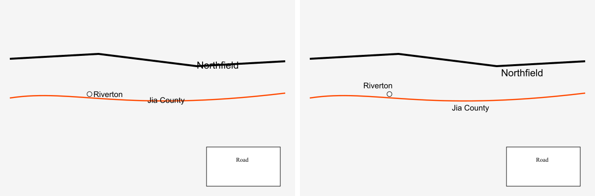

# map-svg-label-placer

Moves the place names on an SVG map so that no name covers a line, a symbol or another name.
You give it the map and a list of labels at rough positions. It returns the positions it chose, plus the
labels it could not fit, so you can decide what to shorten or drop.

It works in two ways:

- on the `<text>` already in the SVG, as on many maps on Wikimedia Commons: it rewrites their `x` and `y` and
  leaves every other byte of the file alone;
- on a separate label file, for maps whose names are laid over the image with `{{Image label}}`, as on Chinese
  Wikipedia. I first wrote this part in Python for my own maps; this is a TypeScript port.



## Why not an existing library

- [vega-label](https://github.com/vega/vega/tree/main/packages/vega-label) avoids other marks, but only inside a Vega chart.
- [d3fc-label-layout](https://github.com/d3fc/d3fc/tree/master/packages/d3fc-label-layout) moves labels away from each other, not away from lines.
- [polylabel](https://github.com/mapbox/polylabel) finds one good point inside a polygon.

I did not find one that reads an arbitrary SVG map and treats the names of points, lines and areas differently.

## Usage

```sh
npm run build
node dist/cli.js svg map.svg --config config.json --out map.placed.svg
node dist/cli.js place fixtures/jia-county/config.json --out placed.json
node dist/cli.js wikitext fixtures/jia-county/config.json --labels placed.json --outdir out
```

`svg` writes a copy of the map with its texts moved. The config is optional; `svg_text.fixed` lists ids of texts
or groups that must stay (a legend, a scale bar), and `svg_text.points` ties a name to its symbol:

```json
{ "svg_text": { "fixed": ["legend"], "points": { "label-riverton": "town-riverton" } } }
```

`place` writes the label file with the new positions. `wikitext` turns it into `{{Image label}}` blocks for
Chinese Wikipedia, plus an HTML page that lays the labels over the map the way the template does, for checking.

```ts
import { placeLabels } from "map-svg-label-placer";

const { doc, failed } = placeLabels(svgText, labelFile, config);
```

The config and label files use the format of the Python scripts, which is documented (in Chinese) at the top of
[`reference/python/map_place_labels.py`](reference/python/map_place_labels.py) and
[`map_labels.py`](reference/python/map_labels.py).
[`fixtures/jia-county/config.json`](fixtures/jia-county/config.json) is a small example.

## How it works

1. Read the SVG: every stroked path, line, polyline and polygon becomes line segments, and small rects, circles and
   the SVG's own text become solid obstacles. Transforms and inherited styles are applied; anything in `<defs>` or
   hidden is skipped. The segments go into a uniform grid.
2. Size each label: SVG texts with the fonts Commons renders them in (below); label files at one em per
   character, with the font size from a style table for the map's display width.
3. Place the labels one by one, most important first. Each kind has its own candidate positions:
   - names of points (towns, stations): around the symbol, nearest first. Ties are broken in the order right, upper right,
     lower right, left, and so on. The label must be less than 0.6 times as far from its own point as from any
     other point.
   - names of lines (rivers, railways): along the line on either side, rotated to follow it.
   - names of areas: rings around the given position, optionally kept inside a polygon of the SVG.
4. Take the first candidate whose box, sampled every 2.5 px, keeps a margin from every line, obstacle and
   placed label. If there is none, leave the label where it was and report it.

On a given JavaScript engine, the same input always gives the same output.

## Text width on Wikimedia Commons

Commons renders SVG with librsvg 2.60 on Debian trixie, so a label must be measured with the fonts installed there,
not with the browser's. Checked against Commons' own PNGs, `sans-serif` is Noto Sans and `serif` is Noto Serif
(Help:SVG still says DejaVu), Arial is Liberation Sans, a missing `font-family` is Liberation Serif, and Chinese
without `xml:lang` falls back to WenQuanYi Zen Hei. [`scripts/font_metrics.py`](scripts/font_metrics.py) takes the
advance widths from those Debian packages. On the test line of `File:SVG_Text_Font_Test.svg` the computed widths
are 1.5–4 px wider than the ink Commons draws (lines of 890–1,040 px), which is the side bearing of the first and last
letters.

## Matching the Python version

The tests run both versions on seven maps (two made up, five drawn for Wikipedia) and compare every chosen
position and every output file. All choices agree and the wikitext is byte-identical; 229 of the 237 numbers
(x, y, angle) are bit-identical and the rest differ by less than 1e-12.

Candidates are sorted and the first free one wins, so one unit in the last place of a sort key or a distance can
change the result. I had to reproduce Python where JavaScript
differs:

- `round(x, 3)` rounds exact ties to even, `toFixed` rounds them up: 0.0625 gives 0.062 and 0.063. They
  disagreed on 25 of 1,989 test values.
- `a // b` for floats: `1 // 0.1` is 9, but `Math.floor(1 / 0.1)` is 10.
- `math.hypot`: `Math.hypot` disagreed on 165 of 504 values. I ported CPython's algorithm, which uses only
  `+ - * /` and `sqrt`, so it also gives the same result in every browser.
- `len("𠀀")` is 1; `"𠀀".length` is 2. Some rare characters in Chinese place names are outside the BMP.

## Limitations

- The search is greedy: a label placed early can take the only spot a later one had.
- Kerning is not applied, so Latin text is measured slightly wide. Label files use 1 em per character.
- SVG texts are moved, not rotated: names along lines keep their angle. Multi-line texts are measured as one line,
  and vertical text is not handled.
- Arcs are treated as straight lines, and arc flags written without spaces (`a5 5 0 015 5`) are misread.
- `<use>` and `<image>` are ignored.
- `sin`, `cos` and `atan2` come from the JavaScript engine and may differ in the last bit between engines.

## Licence

MIT. The real maps in [`fixtures/`](fixtures/README.md) are CC BY-SA 4.0 and contain OpenStreetMap data (ODbL).
